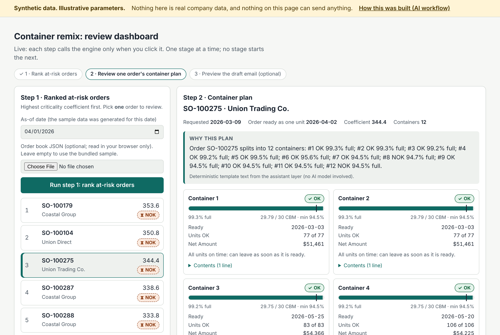

# Order-split & container remix: a supply-planning decision-support tool

[](https://github.com/mertkayilioglu-afk/supply-remix/actions/workflows/tests.yml)

> **Self-directed personal project, built on synthetic data.** It is a rebuild of a tool I used in a previous
> home-appliance supply-planning role (originally Excel/VBA, with Power BI on top). No employer data, code, names
> or contacts are in this repo; customers, products, prices and dates are all generated. All numeric parameters
> (thresholds, weights, capacities, tolerances) are illustrative defaults, configurable in `app/config/`.

**In short**

- **Problem:** a direct-to-customer order ships as one unit, so one late or unplanned line holds back goods that are already ready.
- **Step 1, rank:** split every line by availability date and rank the at-risk orders with configurable weights.
- **Step 2, remix:** for ONE order a planner picks, propose date-ordered containers, each within the fill limits.
- **Step 3, draft:** a customer document and a draft email, never sent. A human reviews every step; no step starts the next.
- **AI** routes a plain-language request to one step and explains the engine's output; it never decides, chains steps or computes numbers. **Start here: [docs/AI_WORKFLOW.md](docs/AI_WORKFLOW.md).**

**Dashboard:** [static demo on GitHub Pages](https://mertkayilioglu-afk.github.io/supply-remix/dashboard/) *(placeholder: live once Pages is enabled)*,
or `GET /dashboard` on the running API. [How it works](#dashboard).



> **The point of this repo is the workflow, not the proposal.** How the same problem is solved differently with AI
> (reverse-engineering legacy VBA, rules as tested config, a safe natural-language layer) is in
> [docs/AI_WORKFLOW.md](docs/AI_WORKFLOW.md). Start there.

## The business problem

A direct-to-customer order with several lines ships as one unit, so it is blocked by its **slowest line**. Most of
its quantity may be ready weeks earlier, while one late or unplanned line holds everything back. Planners used to
find these orders by hand in spreadsheets, decide which mattered most, and then work out which goods could be
shipped together in full containers.

This tool does that work in three steps and leaves the decisions to the planner:

1. **Split** every order line by availability date and work out when each order can really ship.
2. **Score and rank** the at-risk orders by how critical they are (configurable weights).
3. **Propose containers** for one chosen order: the customer's goods, ordered by date, each container at least 94.5% full.

## What it does

**Split.** Each production-feedback chunk becomes a record. An order's *availability of mix* is the latest date across
its lines (`None` if any chunk is UNPLANNED; dates are never faked with sentinel values). A delay under 21 days still
counts as OK, like the legacy tolerance band. Quantity that is ready but trapped in a late order is flagged *recoverable*.

**Score.** A weighted coefficient: ABC class, category, BI/FS, seasonality, seasonal-category bonus, ETD proximity
(linear taper, flat backorder weight) and a *saturating* recoverable-quantity term so a huge low-priority order cannot
outrank a small A-class one. Aggregation across lines is configurable (`max` or `quantity_weighted`). Orders that are
already OK never compete, on purpose.

**Remix (container plan).** For one order, take **every unit** (OK, late and UNPLANNED) of the same customer's
not-yet-shippable orders in the same or a linked category group, and distribute them into containers ordered by date.
Each container shows its fill % and OK/NOK status. Late and unplanned goods stay in their containers, waiting, because
dropping them would look like a cancellation to the customer.

Hard rules:
* Same customer only; one category group per container (goods ship from one plant of origin to one address).
* Every container is between **94.5% and 100%** full (30 CBM capacity).
* The earliest container is filled first. If the last one falls short, units are borrowed from containers above it
  without pushing the donor under the floor. A fully-OK container never donates.
* If total volume cannot cover `94.5% x container count`, **no containers are created** and the reason is stated:
  `no_candidates`, `insufficient_volume` or `cannot_balance`, or `mixed` when the order's category groups failed for
  different reasons (`group_failures` gives each group's own reason). "No proposal" is a legitimate answer.
* A fully-OK container never gives a unit away. It may swap a unit for another OK unit only if it stays fully OK and
  within 94.5%-100%.
* A partial proposal is kept: the customer document and the draft email state plainly which category is not split
  and why.

On the bundled synthetic data, 23 of 61 at-risk orders can be containerised; 33 fail on volume and 5 are `mixed`
(each has one group that cannot balance and another that lacks volume).
In 17 of those 23, at least one of the order's other category groups still fails and is listed with its reason.
This is the rule working as designed, not a bug. It is also the clearest place where real data would change results.
A test (`tests/test_api.py`) pins these numbers, so any change to them is deliberate.

**Working-day calendar (optional, off by default).** When enabled, an availability date that falls on a weekend or a
configured holiday is moved to the next working day *before* any status is computed, so OK/NOK, availability of mix and
container dates all use the date goods can really leave. Requested delivery dates (the customer's own) and UNPLANNED
chunks are never shifted. A moved date keeps its original in `calendar_shifted_from`, shown on each container line.
On the sample data, switching it on (Mon-Fri, no holidays) moves 502 of 1,885 availability chunks but changes no
order's status: the generated delays are far from the 21-day boundary. The effect is real only near that boundary.

**Presentation.** A pivot of at-risk orders by customer and plant (HTML and Excel), a customer-facing Excel container
plan, and a **draft** `.eml` email with the plan attached. Nothing is ever sent: there is no SMTP code anywhere.

## Why it is staged (and where the checkpoints are)

Each step is a separate call with a human looking at the output in between:

| # | Checkpoint | Endpoint | The human decides |
|---|---|---|---|
| 1 | Ranked at-risk orders | `POST /analyze`, `/pivot` | which order is worth acting on |
| 2 | Container plan for one order | `POST /remix` | whether the plan is sensible |
| 3 | Customer document and email draft | `POST /remix/proposal.xlsx`, `/remix/proposal-email.eml` | whether to send anything |

Staging is deliberate, for two reasons: **trust** (a planner can verify each stage before the next builds on it) and
**failure visibility** (a stage that cannot process its input fails loudly with `stage / expected / received`, HTTP 422,
instead of passing a wrong answer downstream). The document stage also refuses to render if its units do not reconcile
with the order.

## Dashboard

A small review page for the staged flow, from one template in two forms:

* **Live:** `GET /dashboard` on the running API. Each step is a deliberate click that calls ONE stage:
  rank at-risk orders (`/analyze`), then the container plan for the one order you pick (`/dashboard/plan`), then,
  optionally, a text preview of the draft customer email (`/dashboard/email-preview`). Nothing runs on page load,
  and no stage starts the next.
* **Static:** `python scripts/build_static_dashboard.py` writes `docs/dashboard/index.html` with a pre-computed
  snapshot of the sample data (the full ranking, plus plans for the top orders and one example of each outcome), so
  it works on GitHub Pages without a server. A test checks the committed file matches a fresh build.
* **GitHub Pages:** `https://mertkayilioglu-afk.github.io/supply-remix/dashboard/` *(placeholder: live once Pages is
  enabled for the `main` branch, `/docs` folder).*

What the page shows: ranked orders (order, customer, coefficient, status); one card per container with a fill bar
that marks the minimum load, an OK/NOK badge (icon and text, not colour alone), ready date, units OK, and Net Amount;
the plain-language reason when there is no proposal, and which category was not split in a partial one; and a
"Why this plan" box with the assistant layer's explanation. Every figure comes from the engine or `app/config/`;
the page itself contains none. There is no send button: the email appears only as a draft preview.

Note: container numbers follow the engine's earliest-first fill order, not the ready date, so a later container can
occasionally be ready before an earlier one. Balancing can move a unit between containers, but the balancing delay
guard (see "Known limits and next steps") stops it from delaying any container by more than 21 days.

## Where AI fits

The question this project answers: *how would I rebuild an Excel/VBA/Power BI workflow today with AI?*

* **AI is the interface, not the decision-maker.** `POST /assistant` takes a plain sentence ("which orders are most at
  risk?", "remix SO-100203"), routes it to one stage, and explains the engine's output in words a planner can read.
* **It never chains stages.** If a sentence spans checkpoints ("rank, remix the top one and email the customer"), only the
  first stage runs; the rest comes back as `deferred_stages` for a human to trigger.
* **Numbers come from code, not the model.** The explanation may only restate numbers the engine produced; if the model
  states any other number, its text is discarded and a deterministic template is used.
* **It degrades safely.** Without `ANTHROPIC_API_KEY` (or if the model fails) routing is rule-based and explanations are
  templated. The tool never depends on the model being available.
* The VBA-era pieces map across like this: macros that found names and built Outlook mails became a contact lookup plus a
  draft `.eml`; pivot tables became a typed API plus HTML/Excel views; tribal-knowledge rules became explicit, tested config.

## Run it

```bash
pip install -r requirements.txt
python scripts/make_sample_data.py          # synthetic order book -> data/sample_order_book.json
python -m pytest -q                         # 149 tests
uvicorn app.api.main:app --reload           # API docs at /docs, review dashboard at /dashboard
export ANTHROPIC_API_KEY=...                # optional: model-based routing and phrasing
```

Example: `POST /remix` with the contents of `data/sample_order_book.json` plus `"target_order_number": "SO-100203"`.

## Layout

```
app/config/        every tunable value (generator, tolerance, scoring weights, remix rules)
app/data/          models and the synthetic data generator (seeded, reproducible)
app/core/          splitter, scoring, remix, StageError
app/presentation/  pivot (HTML/Excel), customer document, email draft, contact lookup, dashboard template
app/ai/            natural-language router and explainer
app/api/           FastAPI app, dashboard routes and Pydantic schemas
docs/dashboard/    static build of the dashboard (GitHub Pages)
tests/             unit tests, including a bounds property test on generated data
```

## Optional: n8n orchestration (untested design example)

[docs/n8n/](docs/n8n/README.md) holds a workflow showing how the checkpoints map onto a schedule: schedule -> `/analyze` -> notify -> human approval -> `/remix` -> human approval -> save a **draft** `.eml` only. It has **not** been run in n8n; only its structure is checked by tests (human-gated, draft-only, nothing can send).

## Known limits and next steps

* The default packer is a greedy, date-ordered heuristic with a local repair step, not an optimiser. An optional MILP
  packer (`RemixConfig(packer="milp")`, PuLP + CBC, time limit per solve) solves the same hard rules exactly on small
  pools. [docs/packer_comparison.md](docs/packer_comparison.md) compares the two honestly: MILP roughly halves the date
  spread inside containers where it solves, builds one extra case, but times out on large pools and is ~30x slower.
  Greedy stays the default.
* **Next step, not built: a greedy/MILP hybrid.** Run the MILP only on small pools (for example up to around 10
  containers) with a short time limit, and keep greedy's plan whenever the MILP times out or does not beat it. The
  evidence for it is thin, and that is why it is a next step and not a feature:
  * the sample data gives only **9 independent cases** (several orders of one customer share a pool), not 61;
  * date spread is the MILP's own objective, so the comparison **favours the MILP on that metric by construction**;
    greedy optimises for "earliest goods leave first" instead;
  * "a fully-OK container never donates" is a *step* in greedy's repair, and had to be **translated into a
    constraint** for the MILP (at least as many fully-OK, in-bounds containers as the plain earliest-first fill).
    That is equivalent in spirit, not line-for-line, so part of the MILP's one extra buildable case may come from
    the translation rather than from better search.

  Before building it: test on real order books, agree with planners which metric matters (spread, wait, or
  earliest-out), and decide whether the translated rule is acceptable.
* The working-day calendar (`app/config/calendar_config.py`) is **off by default** and only reachable through config,
  not per API request. It has no built-in holiday list; the holidays and working week are yours to fill in.
* Contacts, prices and volumes are synthetic; the container capacity and 94.5% floor are configuration, not facts.
* **Repair-step behaviour to be aware of:** the last container borrows from containers *above* it first. Only if
  that cannot fix it (for example, every earlier container would drop under the floor) does the repair borrow from a
  *later* container. Tested in `tests/test_remix.py::TestBorrowing`.
* **Balancing delay guard** (`RemixConfig.max_balancing_delay_days`, default 21 days): a repair move or swap may not
  push a container's ready date more than 21 days past its ready date as the earliest-first fill left it (the first
  fill itself is not restricted). 21 days is the same window under which a delay already counts as OK, so balancing
  may cost a container at most the delay the business already tolerates. Why it exists: on the sample data, the
  repair fixed a 0.0002 CBM shortfall in one container by swapping a unit ready 83 days later into container 1 of
  SO-100275, so 76 on-time units would have waited for one. With the guard, container 1 ships on its own date and
  the late unit goes to a container that was already ready within 21 days of it. On the sample data the guard
  changes no outcome (still 23 built, 33 insufficient volume, 5 mixed) and no container count; it changes which
  container holds which unit in 2 distinct plans (7 orders share them). Tested in
  `tests/test_remix.py::TestBalancingDelayGuard` and `TestSO100275SampleCase`.
* Whether a unit is OK inside a container is decided by the same `AnalysisConfig.status_tolerance_days` the splitter
  uses (there is no second tolerance setting to drift out of sync).
