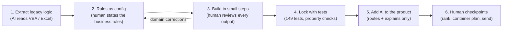

# From Excel/VBA/Power Query to an AI-assisted build

The point of this repo is not the proposal it produces. A proposal can be written by hand. The point is **how the
same business problem gets solved differently when AI is part of the workflow**, and what that changes in speed,
flexibility and trust.

> Context: in a previous supply-planning role I built the original tool in Excel, VBA and Power Query, and it delivered
> real impact. This repo is a self-directed rebuild on synthetic data. I had no prior hands-on AI work; this project
> is how I learned it by doing.

## The workflow at a glance

## 1. What was hard with the VBA/Power Query version

| Pain | What it looked like |
|---|---|
| Rules buried in code | Tolerance days, category links, scoring weights lived inside macros and query steps. Changing one meant reading the macro first. |
| Hidden bugs | Logic nobody re-read for years. Rebuilding it, I found a seasonal-bonus condition written with `And` where it should have been `Or`, so the bonus never fired for some months. |
| One fixed algorithm | Greedy date-ordered packing, hard to adapt when the business rule changed (for example "late goods must stay in containers, not be dropped"). |
| Hard to test | No way to prove a change did not break last month's results. |
| Output without reasoning | A pivot or an Outlook draft, but no explanation of why an order ranked first. |

## 2. What AI changed in the *build*

1. **Reverse-engineering legacy logic.** I gave the AI the exported VBA modules. It read them, described the actual
   algorithm (greedy chronological bin-packing), and surfaced the bug above. I confirmed each finding against how the
   tool behaved in real use before keeping it.
2. **Rules became configuration.** Every tunable value sits in `app/config/`. When the business rule changed (see below), the
   change was a rule edit plus tests, not a macro rewrite.
3. **Tests as the safety net.** 149 tests, including a property test on generated data that every container stays within
   94.5%-100%. AI wrote code quickly; the tests are what made that safe.
4. **Fast iteration on domain feedback.** Examples from this project, each fixed in one working session:
   * Generated categories were not realistic for appliances, so I corrected them and the data was regenerated.
   * The first remix kept only the "best" container; I pointed out that the legacy tool kept all of them, ordered by date.
   * Leaving late goods out of containers would look like a cancellation to the customer, so late and unplanned goods
     now stay in their containers, and every container must reach 94.5%.
   
   The AI could not have known these rules. The domain knowledge was mine; the AI turned it into tested code in hours.

## 3. What AI does in the *running product*

* A plain-language entry point (`POST /assistant`): "which orders are most at risk?", "remix SO-100203".
* It **routes** to one stage and **explains** the result. It never decides, never chains stages, and any number in its
  explanation that the engine did not produce is rejected.
* It degrades safely: no API key, no problem; routing falls back to rules and explanations to a template.

## 4. Where I deliberately did *not* use AI

The numbers (availability dates, scores, container fills) come from deterministic code. A planner has to be able to trust
and audit them, and an LLM can invent plausible figures. Humans approve each checkpoint, and nothing is ever sent to a
customer automatically.

## 5. Efficiency: what I can and cannot claim

* **Original impact (previous role, my own figures, not reproducible from this repo):** the original tool brought roughly
  EUR 1.5M of backorder orders under control, with an estimated saving potential of about EUR 170k per month, and reduced
  manual work by about 3.5 hours per week. These figures come from the original VBA/Power Query tool and company data. They
  cannot be verified here, and nothing in this repository measures money because the data is synthetic.
* **Build effort:** the original took about two months to set up and depended on SAP extracts and Power Query steps. Here the
  same logic is explicit configuration with tests, so a rule change is a config edit plus a test run, and a natural-language
  layer sits on top. I have not measured the time saving of this version.
* **Reliability:** logic is covered by tests and has explicit failure messages, instead of silently producing a wrong sheet.
* **Planner time:** the ranked list, the dashboard and the draft email replace several manual steps. I have not measured it.

## 6. What I would do next with a real team

Connect to live order data instead of generated data, fill the (already built) working-day calendar with real holidays, decide whether a
greedy/MILP hybrid is worth it (see docs/packer_comparison.md), and log planner accept/reject decisions so the scoring weights can be tuned from evidence.
