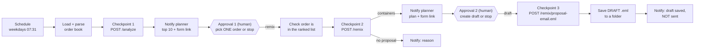

# n8n orchestration: an UNTESTED design example

> **Untested design example.** `supply_remix_staged_review.json` has **not** been imported into n8n or run.
> Node types and parameters follow n8n's documented formats (n8n 1.x), but they were written by hand and are
> not checked against a live instance, so expect to fix parameters after import. The only thing tested is the
> file's *structure*, statically, by `tests/test_n8n_example.py`: valid JSON, every connection points at a real
> node, each API call after `/analyze` sits behind a human approval, and no node can send anything.
> This label stays until the owner has run it.

## What it shows

How the tool's staged checkpoints map onto a scheduled workflow, without the workflow ever deciding or sending
anything itself.

| Step | Node | Why it is there |
|---|---|---|
| Schedule | `Weekday morning` | Runs the *analysis* only. The off-the-hour minute (07:31) avoids the busy :00 slot. |
| Checkpoint 1 | `Checkpoint 1: POST /analyze` | The ranked at-risk list. Nothing else runs until a person responds. |
| Notify | `Notify planner: ranked list` | Slack message with the top 10 (the engine's numbers, only formatted) and a form link. |
| Approval 1 | `Approval 1: planner picks ONE order` | n8n *Wait* node resumed by a form. The planner types one order number, or stops. |
| Guard | `Order is in the ranked list?` | Fails the execution visibly if the typed order is not in today's ranking, instead of remixing it. |
| Checkpoint 2 | `Checkpoint 2: POST /remix` | Container plan for that one order. A "no proposal" result is reported with its reason and the run ends. |
| Approval 2 | `Approval 2: create a DRAFT customer email?` | Second human decision, after seeing the plan. |
| Checkpoint 3 | `Checkpoint 3: POST /remix/proposal-email.eml` | Returns the `.eml` with the Excel plan attached. The API itself has no send capability. |
| Draft only | `Save DRAFT .eml (never sent)` | Writes the file to a drafts folder. A person opens it, reviews it, and sends it themselves. |

## Rules it keeps

* **No stage triggers the next.** Every call after `/analyze` sits behind a Wait-for-form node; the "Stop"
  choice (or the false branch of an IF) ends the run.
* **One order at a time.** The planner names one order; the workflow never loops over the ranking.
* **Draft only.** There is no Send Email, SMTP or Gmail-send node. If you would rather create the draft in a
  mailbox, swap the save step for a mail node's *create draft* operation, never *send*.
* **No AI in the loop.** It calls the deterministic endpoints directly, not `/assistant`.

## Setup if you want to try it

1. Run the API somewhere n8n can reach: `uvicorn app.api.main:app --host 0.0.0.0`.
2. In n8n, set environment variables:
   * `SUPPLY_REMIX_API_URL`, e.g. `http://localhost:8000`
   * `SUPPLY_REMIX_ORDER_BOOK`, path to an order book JSON in the format of `data/sample_order_book.json`
   * `SUPPLY_REMIX_DRAFTS_DIR`, folder for the draft `.eml` files
   * `SUPPLY_REMIX_SLACK_CHANNEL`, channel name for the notifications (or replace the Slack nodes with any notifier)
3. Import `supply_remix_staged_review.json`, attach Slack credentials, and check every node's parameters.
   The workflow is saved **inactive**.
4. Run it manually first. The order book is read once per execution and reused by every later call, so all three
   checkpoints see the same data. They do **not** pin `as_of_date`: if an approval waits overnight, `/remix` and the
   email use the next day as "today". That only moves the coefficient shown next to the plan, not the containers,
   but passing the `/analyze` response's `as_of_date` into the later calls would close it. Not done here.

If you run it, record the n8n version and what you had to change, and remove the "untested" label only then.
